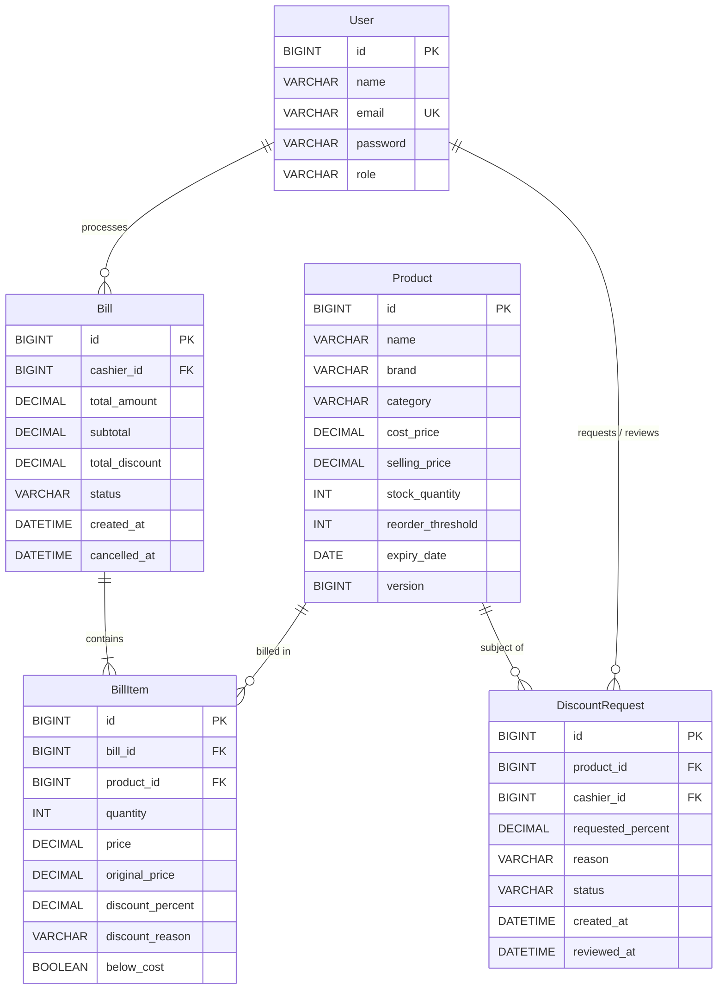

# OptiStock AI - Technical Architecture & Report Notes

## 1. System Architecture

OptiStock AI follows a clean, decoupled 3-tier enterprise architecture built on modern Spring Boot and React ecosystems.

```
+-------------------------------------------------------------------------------+
|                               Frontend Layer                                  |
|   React 19 + Vite 6 Single Page Application                                  |
|   - Cashier: Spatial UI (visionOS 3D layout, perspective & depth elevation)   |
|   - Manager: Frosted Glassmorphism UI (Multi-tab, Recharts visual analytics)  |
+-------------------------------------------------------------------------------+
                                      |  HTTP / REST (JSON)
                                      v
+-------------------------------------------------------------------------------+
|                             Security & API Gateway                            |
|   - Stateless TokenAuthenticationFilter (Bearer token validation)             |
|   - Spring Security 6 Authorization rules (Role-based access control)          |
|   - GlobalExceptionHandler (Unified RFC-compliant error envelopes)             |
+-------------------------------------------------------------------------------+
                                      |
                                      v
+-------------------------------------------------------------------------------+
|                              Service Layer                                    |
|   - ExpiryPricingService (Dynamic markdown calculation & safety checks)       |
|   - BillService (Atomic checkout, inventory deduction, margin guardrails)    |
|   - ManagerService (Demand forecasting, reorder urgency, 80/20 product mix)   |
|   - AuthService (Credential authentication & bearer token issuance)           |
+-------------------------------------------------------------------------------+
                                      |
                                      v
+-------------------------------------------------------------------------------+
|                            Persistence Layer                                  |
|   - Spring Data JPA + Hibernate 6 ORM                                         |
|   - Repositories with custom JPQL & Native aggregation queries                |
|   - MySQL 8 (Production) / In-Memory H2 MySQL Mode (Demo & Testing)           |
+-------------------------------------------------------------------------------+
```

---

## 2. Database Schema & Entity Relationships

The data model is normalized to maintain relational integrity while supporting high-speed point-of-sale checkout operations and analytics queries.

### 2.1 Entity Overview

| Table | Entity | Description |
| :--- | :--- | :--- |
| `users` | `User` | Store operators (`MANAGER` or `CASHIER`) with hashed credentials |
| `products` | `Product` | Master SKU catalog with inventory counts, thresholds, and expiry dates |
| `bills` | `Bill` | Checkout transaction header record with financial subtotals and status |
| `bill_items` | `BillItem` | Transaction line item recording billed unit price, discount, and margin |
| `discount_requests` | `DiscountRequest` | Workflow requests for below-margin discounts requiring manager sign-off |

### 2.2 Relational Structure & Constraints



---

## 3. API Endpoint Catalog

All protected endpoints require `Authorization: Bearer <token>` in the HTTP request headers.

### Authentication (`/api/users`)
- `POST /api/users/login`: Authenticates credentials and returns a bearer token with user role and profile details.

### Catalog Management (`/api/products`)
- `GET /api/products`: Retrieves all active catalog items with real-time calculated expiry statuses, effective prices, and days left (Authenticated).
- `POST /api/products`: Creates a new SKU catalog entry (`ROLE_MANAGER` only).
- `PUT /api/products/{id}`: Updates an existing product (`ROLE_MANAGER` only).
- `DELETE /api/products/{id}`: Deletes a SKU from the catalog (`ROLE_MANAGER` only).

### Billing & Point of Sale (`/api/bills`)
- `POST /api/bills`: Creates and processes an atomic bill transaction with stock decrementation and expiry/margin validation.
- `GET /api/bills`: Retrieves transaction history filtered by optional date parameter. Cashiers only see their transactions; managers see store-wide data.
- `PUT /api/bills/{id}/cancel`: Voids a completed bill and automatically restocks all item inventory (`ROLE_MANAGER` only).

### Manager Analytics & Optimization (`/api/manager`)
- `GET /api/manager/forecast`: Returns 30-day demand forecast, daily average velocity, days of cover, and suggested replenishment.
- `GET /api/manager/reorder`: Lists items requiring immediate reorder (stock $\le$ threshold OR days of cover $< 7$), sorted by urgency.
- `GET /api/manager/alerts`: Aggregates active inventory alerts (Low Stock, Expiring Soon, Markdown Active, Expired in Stock, Slow-Moving SKUs).
- `GET /api/manager/summary`: Store performance dashboard summary (gross sales, net sales, discount totals, clearance markdowns, daily trends, top 5 SKUs).
- `GET /api/manager/ranking`: SKU profitability leaderboard ranked by absolute net profit and margin percentage.
- `GET /api/manager/product-mix`: Pareto 80/20 category optimization suggestions based on historical contribution margins.

### Discount Approval Workflow (`/api/discount-requests`)
- `POST /api/discount-requests`: Submits a manual discount approval request for an item.
- `GET /api/discount-requests/pending`: Lists all open discount requests awaiting manager action (`ROLE_MANAGER` only).
- `PUT /api/discount-requests/{id}/approve`: Approves a discount request (`ROLE_MANAGER` only).
- `PUT /api/discount-requests/{id}/reject`: Rejects a discount request (`ROLE_MANAGER` only).

---

## 4. Mathematical Formulations & Business Rules

All financial values are computed in `BigDecimal` with a scale of 2 using `RoundingMode.HALF_UP` under the `Asia/Kolkata` timezone.

### 4.1 Dynamic Expiry Markdown Pricing
Let $\Delta d = \text{ChronoUnit.DAYS.between}(\text{today}, \text{product.expiryDate})$:
$$\text{Status} = \begin{cases}
\text{EXPIRED} & \text{if } \Delta d < 0 \implies \text{Sale Blocked (400 Bad Request)} \\
\text{LAST\_DAY} & \text{if } \Delta d = 0 \implies \text{Discount} = 70\% \\
\text{MARKDOWN} & \text{if } 1 \le \Delta d \le 2 \implies \text{Discount} = 50\% \\
\text{EXPIRING\_SOON} & \text{if } 3 \le \Delta d \le 4 \implies \text{Discount} = 0\%, \text{Flagged in Alerts} \\
\text{NORMAL} & \text{if } \Delta d \ge 5 \text{ or expiryDate is null} \implies \text{Discount} = 0\%
\end{cases}$$

$$\text{EffectivePrice} = \text{BasePrice} \times \left(1 - \frac{\text{DiscountPercent}}{100}\right)$$
$$\text{BelowCost} = \text{EffectivePrice} < \text{CostPrice}$$

### 4.2 Minimum Profit Margin Protection
For non-clearance manual discounts:
$$\text{MarginPercent} = \frac{\text{EffectivePrice} - \text{CostPrice}}{\text{EffectivePrice}} \times 100$$
$$\text{Condition: If } \text{MarginPercent} < 10\% \implies \text{Requires Manager Approved Request ID}$$

### 4.3 Weighted Moving Average (WMA) Demand Forecasting
Sales volume over the past 30 days is partitioned into two time horizons:
- $S_7$: Units sold in the last 7 calendar days.
- $S_{23}$: Units sold in the preceding 23 calendar days (days 8 to 30).

Recent velocity is weighed double ($2\times$):
$$\text{AvgDailySales} = \frac{(S_7 \times 2) + S_{23}}{37}$$
$$\text{Forecast}_{30} = \left\lceil \text{AvgDailySales} \times 30 \right\rceil$$
$$\text{DaysOfCover} = \begin{cases} 
\frac{\text{StockQuantity}}{\text{AvgDailySales}} & \text{if } \text{AvgDailySales} > 0 \\
999.00 & \text{if } \text{AvgDailySales} = 0 \text{ and Stock} > 0 \\
0.00 & \text{if } \text{AvgDailySales} = 0 \text{ and Stock} = 0 
\end{cases}$$

### 4.4 Replenishment Reorder Calculation & Perishable Capping
$$\text{TargetStock} = \lceil \text{Forecast}_{30} \times 1.10 \rceil \quad (\text{includes 10\% safety buffer})$$
$$\text{SuggestedReorderQty} = \max(0, \text{TargetStock} - \text{StockQuantity})$$

For SKUs with an expiration date ($\Delta d > 0$):
$$\text{SuggestedReorderQty} = \min\left(\text{SuggestedReorderQty}, \max(0, \lfloor \text{AvgDailySales} \times \Delta d \rfloor)\right)$$
If $\Delta d \le 0$, $\text{SuggestedReorderQty} = 0$.

### 4.5 Pareto 80/20 Product Mix Optimization
Within each category:
$$\text{ProductScore} = \max(0, \text{MarginPercent} \times \text{QuantitySold})$$
1. Products are sorted in descending order by score.
2. The top performer receives a **suggested share of 80%**.
3. The remaining alternatives distribute the **remaining 20%** proportional to their scores:
$$\text{SuggestedShare}_i = \frac{\text{Score}_i}{\sum_{k \in \text{alternatives}} \text{Score}_k} \times 20\%$$
(If all alternative scores are 0, the 20% share is divided equally).

---

## 5. Future Scope & Roadmap

1. **Hardware & Peripheral Integration**: WebUSB / Serial API drivers for physical thermal receipt printers, electronic cash drawers, and 2D handheld barcode/QR scanners.
2. **Automated Supplier EDI Replenishment**: Direct Electronic Data Interchange (EDI 850) integration to auto-transmit purchase orders to wholesale distributors when reorder thresholds trigger.
3. **Machine Learning Weather & Event Correlation**: Ingestion of local meteorological forecasts and regional holiday calendars to model non-linear demand spikes for seasonal produce.
4. **Multi-Store Inventory Balancing**: Centralized management portal enabling intra-store stock transfers before initiating new supplier orders.
